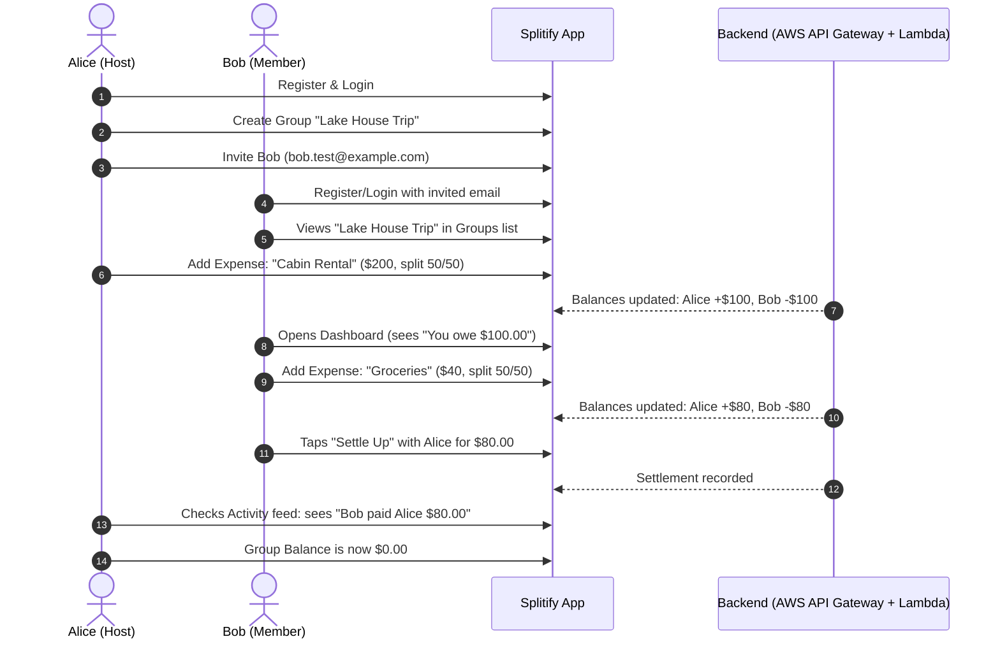

# Splitify — Alpha Release Test Plan

## 1. Executive Summary & Objective

The objective of this test plan is to validate all user-facing workflows and backend services of **Splitify** prior to distributing the Alpha build to initial external testers. 

### Target Platforms
- **Web App**: CloudFront HTTPS (`https://d2i4wcpsg76nmm.cloudfront.net`) tested on Chrome, Safari, and Firefox.
- **iOS**: Simulator / TestFlight (iOS 16+).
- **Android**: Emulator / Internal App Sharing (Android 12+).

### Exit Criteria for Alpha
- All Critical (P0) workflows pass without application crashes or unhandled promise rejections.
- Net debt calculations and settlement math are 100% mathematically consistent.
- Cognito authentication and session persistence function smoothly across restarts and page reloads.

---

## 2. Test Setup & Prerequisites

### Test Accounts
Prepare **three test user personas** to thoroughly test multi-user group interactions:
- **User A (Host)**: `alice.test@example.com`
- **User B (Member 1)**: `bob.test@example.com`
- **User C (Member 2)**: `charlie.test@example.com`

---

## 3. Comprehensive Feature Test Matrix

| ID | Module | Test Case | Steps | Expected Result | Priority |
| :--- | :--- | :--- | :--- | :--- | :--- |
| **AUTH-01** | Auth | Sign Up (New User) | 1. Navigate to Sign Up.<br>2. Fill in Email, Password, Name.<br>3. Submit and verify OTP code from email. | Verification succeeds; user account created in Cognito; redirected to Login/Dashboard. | **P0** |
| **AUTH-02** | Auth | Sign In (Valid Credentials) | 1. Enter verified email & password.<br>2. Click Sign In. | User lands on Dashboard; JWT tokens stored in AsyncStorage / SecureStore. | **P0** |
| **AUTH-03** | Auth | Sign In (Invalid Credentials) | 1. Enter wrong password. | Informative error message displayed; app does not crash. | **P1** |
| **AUTH-04** | Auth | Forgot Password Flow | 1. Click "Forgot Password".<br>2. Enter email.<br>3. Submit verification code & new password. | Password reset confirmed; user can log in with new password. | **P1** |
| **AUTH-05** | Auth | Session Persistence | 1. Log in.<br>2. Close browser/app and reopen. | User remains logged in without re-authenticating. | **P0** |
| **AUTH-06** | Auth | Sign Out | 1. Open Profile tab.<br>2. Click Sign Out. | Session tokens cleared; user redirected to Login screen. | **P1** |
| **GRP-01** | Groups | Create Group | 1. Click "Create Group".<br>2. Enter Name (e.g., "Ski Trip 2026") & Category.<br>3. Submit. | Group created in S3/Dynamo; creator added as member; group appears on Dashboard & Groups screen. | **P0** |
| **GRP-02** | Groups | List Groups | 1. Navigate to Groups tab. | All groups user belongs to are displayed with correct member counts. | **P0** |
| **GRP-03** | Groups | Invite Member by Email | 1. Open group.<br>2. Tap "Invite Member".<br>3. Enter `bob.test@example.com`. | Member added or invitation logged; Bob can see group upon next login. | **P0** |
| **EXP-01** | Expenses | Add Expense — Split Equally | 1. Select Group.<br>2. Tap "+ Expense".<br>3. Amount: $60.<br>4. Paid by Alice, split equally with Bob & Charlie. | Expense created ($20 each); Alice is owed $40; Bob owes $20; Charlie owes $20. | **P0** |
| **EXP-02** | Expenses | Split with Remainder / Odd cents | 1. Add $100 expense split equally between 3 people. | Math handles rounding properly ($33.34 + $33.33 + $33.33 = $100.00). | **P1** |
| **EXP-03** | Expenses | Add Expense — Split by Exact Amounts | 1. Amount: $50.<br>2. Alice pays $50.<br>3. Bob: $30, Charlie: $20. | Custom splits correctly stored and reflected in balances. | **P1** |
| **EXP-04** | Expenses | Add Expense — Split by Percentage | 1. Amount: $100.<br>2. Bob 60%, Charlie 40%. | Backend calculates $60 and $40 shares accurately. | **P1** |
| **EXP-05** | Expenses | Attach Receipt Image | 1. Tap "+ Expense".<br>2. Select/upload an image.<br>3. Save expense. | Image uploaded to S3 via pre-signed URL; thumbnail preview visible in Expense Detail. | **P1** |
| **EXP-06** | Expenses | View Expense Detail | 1. Tap an expense in group list. | Shows full details: payer, participants, breakdown, date, category, attached receipt, comments. | **P0** |
| **EXP-07** | Expenses | Edit Expense | 1. Open Expense Detail.<br>2. Edit amount or description.<br>3. Save. | Expense updated; balances recalculate immediately. | **P1** |
| **EXP-08** | Expenses | Delete Expense | 1. Open Expense Detail.<br>2. Tap Delete. | Expense removed; group balances revert correctly. | **P1** |
| **BAL-01** | Balances | Group Net Balances | 1. Check Group Balances tab after multiple expenses. | Net balance for every member matches sum of paid vs owed. Sum of all balances = $0.00. | **P0** |
| **BAL-02** | Balances | Dashboard Overall Balance | 1. Check home screen. | Displays aggregate "You are owed" and "You owe" across all groups. | **P0** |
| **SET-01** | Settle Up | Record Full Payment | 1. Bob owes Alice $20.<br>2. Bob taps "Settle Up" -> selects Alice -> enters $20. | Settlement recorded; Bob's balance with Alice becomes $0.00. | **P0** |
| **SET-02** | Settle Up | Record Partial Payment | 1. Bob owes Alice $50.<br>2. Bob settles $20. | Balance updates from -$50 to -$30. | **P1** |
| **ACT-01** | Activity | Feed Stream & Name Resolution | 1. Navigate to Activity tab. | Activities list who added/edited expenses and settlements. Uses friendly names ("Alice", "You") rather than raw Cognito UUIDs. | **P0** |
| **ANL-01** | Analytics | Spending Analytics Screen | 1. Navigate to Group Analytics. | Charts render without errors; category spending totals are accurate. | **P2** |
| **COM-01** | Comments | Add Comment on Expense | 1. Open Expense.<br>2. Post comment. | Comment renders with author name and timestamp. | **P2** |
| **UI-01** | Responsiveness | Mobile Web Viewport | 1. Open web app on mobile browser or narrow window. | Layout scales cleanly; bottom navigation and modals fit screen. | **P1** |

---

## 4. Multi-User End-to-End Alpha Test Script

Run this sequential scenario with 2 devices or 2 browser profiles to verify complete multi-user flow:



---

## 5. Bug Severity & Triage Guidelines

| Severity | Criteria | Action |
| :--- | :--- | :--- |
| **Blocker (S1)** | App crashes on launch, data loss, balance math incorrect, inability to sign in or add expense. | Halts Alpha distribution. Must be fixed immediately. |
| **Major (S2)** | Core feature unusable on specific platform (e.g. receipt camera fails on Android), edit expense fails. | Must be fixed before expanding Alpha beyond core team. |
| **Minor (S3)** | UI glitch, styling alignment, delayed chart rendering, confusing validation error message. | Queue for Beta milestone. |
| **Cosmetic (S4)** | Minor spacing, typo, font styling inconsistencies. | Low priority backlog. |

---

## 6. Recommended Next Steps for Alpha Readiness

1. **Conduct End-to-End Test Run**: Execute the Multi-User scenario script on the live web environment.
2. **Build Mobile Preview Packages**: Generate Expo EAS preview builds for iOS and Android:
   ```bash
   eas build --platform all --profile preview
   ```
3. **Set Up Error Monitoring**: Add Sentry or CloudWatch Alerting to catch runtime exceptions during tester usage.
